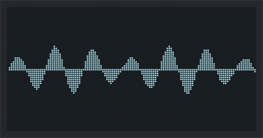

# Morsel

<p align="center">
  
</p>

A browser-based groovebox for the **Novation Launchkey Mini MK4 25**. Morsel puts the Launchkey in DAW mode over Web MIDI and takes over its pads, encoders, buttons and screen, turning it into a standalone sampler, step sequencer and song arranger. You don't need a DAW.

## Features

- **16-pad sampler**: velocity-sensitive pads with start/end, pitch, attack/decay, HP/LP filters with resonance, pan and volume. Pad pressure (aftertouch) opens the filters on note-repeat hits.
- **Pad modes** (cycle with Func):
  - **Play**: play the pads.
  - **Step**: 16-step grid for the selected track (on a drum track, the selected pad; on a keys track, the last key you played is the note). Step mode opens the **Step** encoder page: 1 = pattern length (1–4 bars, every track; shortening drops the notes past the end, Undo brings them back), 2 = the bar on the pads, 3 = swing, 4 = quantize. The arrows still reach the track's other pages, and leaving Step mode returns to the page you were on.
  - **Track**: top pad row selects tracks 1–8, bottom row mutes them (double-tap = solo).
  - **Mixer**: tap a pad of the drum track (the last one picked) to mute it, double-tap to solo.
  - **Pattern**: switch patterns; while playing, the switch waits until the loop ends.
- **Tracks** (MPC style): up to 8 tracks, each a **Drum** rack (16 pads) or a **Keys** instrument. Pick one in the track strip under the pattern buttons, in Track mode, or step through them with **Shift + Pad ⌃ / ⌄** (the Launchkey's own "< Track / Track >"). Everything follows the selected track:
  - The Launchkey screen's header shows it (`T2 Keys 1`).
  - The on-screen pads and the **Track** tab show the drum rack (pads, kits, sampling, sidechain) or the keys instrument.
  - The encoder pages hide what doesn't apply. Drum tracks: Kit, Pad, Pad 2, Track FX, Mix, Global, Duck. Keys tracks: Keys, LFO, Track FX, Mix, Global. The Keys page follows the sound source: synth (preset, waves, detune, filter, envelope), Sample (sample from the library, root note, attack, release, cutoff, resonance) or Pad sample (source pad).
  - On a keys track the 16 pads play notes C3–D#4 of that track and record into its clip.
  - The keybed always plays the last keys track you picked, so on a drum track you can still drum and play keys at once.
- **Sequencer**: 16 patterns (sequences) of 1–4 bars, each holding one clip per track, with live recording (count-in, overdub), quantize, swing, note repeat, metronome and undo.
- **Keys**: an instrument per keys track, played from the keybed (or the pads) and recorded into that track's clip. The Launchkey's Arp and Scale still work. Four sources:
  - **Synth**: two oscillators, filter and envelope, with presets.
  - **Sample**: one sound of its own (load, drop or pick from the library) with a root note, attack, release, cutoff and resonance.
  - **Pad sample**: a drum pad's sample.
  - **Multisample**: a folder of note-named samples.
- **LFO** (keys tracks): a vibrato (rate, ±100 cents) and a filter LFO (rate, ±2 octaves) on every note, for all four sources. In the Keys panel and on the Launchkey's **LFO** encoder page (with the keys volume on encoder 5). Bounces include them.
- **Matrix** (Song tab): sequences × tracks; click a row to play it, a cell to edit that clip; copy, paste and clear single clips.
- **Mixer** (Mixer tab): per track a filter, 3-band EQ, drive and compressor, pan, level, mute/solo, and sends to a shared reverb (A) and tempo-synced delay (B). The Launchkey has a **Track FX** encoder page (selected track) and a **Mix** page (encoders 1–8 = track levels). Bounces include the FX.
- **Song mode**: chain patterns into a song, then bounce the song or one pattern to WAV.
- **Browse** (Shift + Encoder-page ⌃, drum tracks): browse imported sample folders and kits from the hardware, with auto-preview.
- **Drum kits**: a new project and every new drum track (*+ Drums*) start with the synthesized **Factory** kit. The **kit bar** at the top of a drum track's Track tab (◀, the kit list, ▶) works like the Keys presets: it loads the Factory kit or a saved kit onto that track and shows which kit it plays. On the Launchkey, the **Kit** encoder page (the first page of a drum track) scrolls the kits with encoder 1 and the screen lists them; Browse → Kits works too. The Kits panel saves (asking before it replaces one), renames (pick a kit, type the new name, *Rename*), exports (a `.morsel-kit.json` with the samples), imports (several files at once) and deletes kits. *Folder → pads…* imports a folder and puts its first 16 samples (by name) on pads 1–16; on the Launchkey, Shift + Func on a sample folder in Browse does the same. Closed and open hats are put in the same choke group.
- **Sampling**: Shift + Record arms a take from the audio input, the master out or a shared browser tab. Recording starts with the sound and stops on Shift + Record or at the maximum length (30 s, 2 minutes for a tab). The take opens in the Chop editor with its hits already marked (*Take → Chop*), or goes on the selected pad (*Take → pad*).
- **Tab capture**: pick source *Browser tab* and click *Share tab…* once (tick "Share tab audio" in Chrome's picker). The share stays open, so Shift + Record on the Launchkey arms a take and recording starts when the tab plays.
- **Keys presets**: 16 factory synth sounds (Sub Bass, Acid Bass, Reese, Pluck, Leads, Brass, Pads, Strings, Organ, Bell, …) plus your own (*Save as preset* on a keys track's Track tab). On the Launchkey, the **Keys** encoder page scrolls presets with encoder 1 (the screen lists them) and edits waves, detune, cutoff, resonance, env, attack and release with encoders 2–8. A * marks an edited preset.
- **Pattern copy**: *Copy to…* on the Sequencer tab, or in Pattern mode hold a pattern pad and tap another. *Copy clip to…* (or holding Scene as well) copies only the selected track's clip.
- **Sidechain ducker** (like the MPC's Mother Ducker): every hit of an input pad dips a target (one pad, a whole track, or all others) by Depth, holds it down for Hold and lets it recover over Release. Set it in the Sidechain panel on a drum track's Track tab or on the Launchkey's **Duck** encoder page of a drum track (enc 1 on/off, 2 input, 3 target, 4 depth, 5 attack, 6 hold, 7 release); on that page the screen shows the envelope and live gain reduction, and hitting a pad makes it the input. Sequenced hits duck sample-accurately and the duck is included in exports.
- **Start-up animation**: a blob eats a waveform on the Launchkey screen, burps, and the logo bounces in (any input skips it).
- **Light / dark theme**: the ☀ / ☾ button next to Guide switches the on-screen UI (remembered in this browser; the Launchkey screen preview stays dark). The layout tightens on short screens such as 13" and 14" laptops.
- **Deleting samples**: *Delete sample* on a drum track's Track tab or *Delete* in the Chop tab removes a sample from the library and clears every pad (and Keys zone) using it.
- **Chop editor** (Chop tab): zoomable waveform of a whole sample. Click to add slice markers, drag to move, double-click to remove; auto-place by transients or equal parts; Space plays the region and **M** drops a marker at the playhead (tap-chop); 1–9 audition slices. Markers snap to zero crossings. **→ New drum rack** crops to the region and puts the slices on pads 1–16 of a new drum track ("Chop 1", …); *Send* puts them on the current drum track from a chosen pad instead, and *Crop to region* makes a new sample. While a chop is open the Launchkey is in Chop mode: pads play slices 1–16 (and select that slice's marker), encoder 1 scrolls, 2 zooms, 3 picks a marker, 4 moves it (Shift = fine, single samples), 5 sets the most slices and 6 the sensitivity (both re-detect the hits), Play plays from the selected marker (Shift + Play starts / stops the sequencer), Scene adds a marker at the playhead (Shift + Scene removes the selected one), and **Func sends the slices to a new drum rack**. Shift + Encoder-page ⌄ chops the selected pad's sample and leaves Chop again. The screen shows the zoomed waveform with markers.
- **Screen**: the Launchkey screen shows the selected track and the pattern and transport (`P1 PLAY`, `REC`, `COUNT`, `SAMPLE`) in its header on every mode screen, and, per mode: in Play the pad's waveform, the keys presets or samples, the duck curve, or on the LFO, Track FX, Mix and Global pages their 8 encoders with values and level bars; the step grid (Step), the browser (Browse), the chop (Chop) or the 16 pads as cells (Track, Mixer, Pattern), plus popups for mode and track changes and encoder values (on the 8-encoder screens the turned cell lights up instead), rendered as a bitmap. Holding Shift shows what Shift does with each button in the current mode.
- **Persistence**: everything autosaves in the browser's IndexedDB. Projects and kits export as single JSON files with the samples embedded.

### Record → chop → drum rack

All on the Launchkey:

1. **Shift + Record**, then play the sound (into the mic, the master out or a shared tab).
2. **Shift + Record** again. The take opens in Chop with its hits marked; pads 1–16 play the slices.
3. Optionally fix the slices: encoder 5 or 6 re-detects the hits, Scene adds a marker at the playhead, encoders 3 and 4 pick and move a marker.
4. **Func**. A new drum track with the slices on its pads is selected and the Launchkey goes back to Play mode. Undo (Shift + Func) takes it back.

The **Help** tab in the app has the full hardware map, mode overview, encoder pages and shortcuts. Press `?` anywhere to open it.

## Requirements

- A **Chromium-based browser** (Chrome, Edge, Arc, Brave). Web MIDI with SysEx is required, and Safari doesn't support it.
- A Launchkey Mini MK4 25, connected over USB.
- **Close Ableton Live** (or any other DAW using the Launchkey's DAW port) before connecting.

## Getting started

```sh
cd app
npm install
npm run dev
```

Open the URL Vite prints and allow MIDI (with SysEx) access when the browser asks. The dot next to the Morsel logo turns green once the Launchkey is found.

Load samples by dropping audio files onto an on-screen pad, or use **Import folder** to add a whole folder to the browser.

## Scripts

Run these inside `app/`:

| Command | What it does |
|---|---|
| `npm run dev` | Dev server with HMR |
| `npm run build` | Type-check and production build to `app/dist` |
| `npm run preview` | Serve the production build |
| `npm test` | Unit tests (Vitest) |
| `npm run lint` | Lint (Oxlint) |
| `npm run kits -- "<packs folder>"` | Build kit files from a folder of sample packs into `kits/` (needs ffmpeg). Each pack's drum one-shots are sorted by name into kick, snare, clap, hats, … and laid out like the Factory kit; big packs get an A and a B kit. Import them with *Import kits…* |
| `npm run boot-gif` | Re-render `docs/boot-animation.gif` from the start-up animation code (needs ffmpeg) |
| `npm run og-image` | Re-render the link preview `public/og-image.png` and `public/apple-touch-icon.png` (from `public/favicon.svg`) (needs rsvg-convert) |
| `npm run deploy` | Build and deploy to Cloudflare as the `morsel` Worker (static assets, see `app/wrangler.jsonc`). Log in once with `npx wrangler login` |
| `npm run preview:worker` | Build and serve it locally in the Worker runtime |

## Project layout

```
app/src/
  midi/      Launchkey connection, DAW-mode protocol, SysEx
  modes/     Hardware modes (play/step/track/mixer/pattern/browse/chop) and controller logic
  seq/       Sequencer clock, timing/quantize, offline render + WAV export
  audio/     Audio engine, voices, DSP, sampling, sample chopping, kits
  display/   Screen bitmap: frame buffer, fonts, widgets, screens
  state/     Zustand store, types, IndexedDB persistence, project/kit files
  browse/    Sample browser tree
  ui/        React panels (Pads, Sequencer, Keys, Mixer, Song/Matrix, Help, Lab)
  params.ts  Encoder pages and parameters
kits/        Saved kit files (*.morsel-kit.json, git-ignored: they embed samples)
protocol_notes.md  DAW-mode protocol details measured on the hardware
```

## Hardware notes

The Launchkey's DAW-mode protocol differs from Novation's programmer's guide in several places. For example, the bitmap ack, the button channels and the LED channels are different. `protocol_notes.md` lists what was measured on the device and what is still unverified. Use the **Lab** tab to test raw MIDI and screen bitmaps against the hardware.

## File formats

- **Project** (`*.morsel.json`): `{ format: "morsel", version: 2, project, samples }`. Version 1 projects (one drum rack and one Keys instrument) load as a Drums and a Keys track.
- **Kit** (`*.morsel-kit.json`): `{ format: "morsel-kit", version: 1, name, pads, samples }`.
- Files exported before the rename to Morsel (`*.launchkit.json`, `*.launchkit-kit.json`) still import.

In both formats, the samples are stored as 16-bit PCM, base64-encoded per channel.
